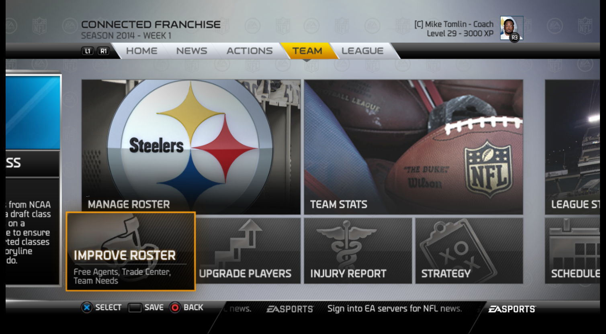

<div align="center">


# Madden NFL 25 Draft Class Patch (PS3 / RPCS3)

Import **750 college prospects** into Connected Franchise instead of 300, with their real schools.


<br>

</div>



## What you get

- **750-player draft classes.** Madden normally keeps only the top 300 players from an NCAA Football 14 draft class. With this patch it keeps up to 750.
- **The right colleges.** Every player shows his real school, including FCS schools Madden never had (Incarnate Word, Stonehill, Lamar and more) and a few Division II and III schools.
- **More free agents.** Madden deletes extra free agents every offseason. The patch lets it keep twice as many (about 1,150), so undrafted rookies stick around.
- **A ready-made class.** `FCS2026`: 2026 prospects from FBS, FCS and six Division II / III standouts, built from the [FCS mod](https://fcs-mod.online) for NCAA Football 14.

## Install

You need Madden NFL 25 (**BLUS31178**, disc version 01.00) added to RPCS3 as a game folder (not an ISO).

1. Download **`madden25-draft-patch.exe`** from [Releases](../../releases).
2. Close RPCS3.
3. Put the exe in your RPCS3 folder (next to `rpcs3.exe`) and double-click it. You can also run it from anywhere and paste the RPCS3 folder when it asks.
4. Press **1**, then Enter.
5. Start RPCS3 and begin a **new** Connected Franchise.
6. When the season starts, Madden offers to import an NCAA Football 14 draft class. Pick **FCS2026**.

Windows may warn that the exe is from an unknown publisher (it is not code-signed). The SHA-256 of each release is listed next to it.

### Already have a franchise?

A franchise you started **before** installing needs one extra step, before you import the draft class: run the exe again, press **2** and pick the franchise. It is backed up first. New franchises do not need this.

### Uninstall

Run the exe, press **3** and type `YES`. The game files, the RPCS3 patch and the draft class go back to how they were. Backups live in `madden25-draft-patch-backups` inside your RPCS3 folder.

## What the exe changes

| Where | Change |
| --- | --- |
| RPCS3 patch (`patches/imported_patch.yml`, enabled in `config/patch_config.yml`) | Raises the draft import from 300 to 750 and gives franchise mode the memory for it. Your other patches are left alone. |
| Madden's college lists (6 places in `QKL_BOOT`, `QKL_FE2IG`, `QKL_INTERFACE`, `QKL_MISC`) | Correct school for every draft prospect. |
| New-franchise template (`QKL_MISC`) | Room for 750 prospects, 5,000 players and twice the free agents. |
| Your saves | Adds the `FCS2026` draft class save. Option 2 grows an older franchise save the same way. |

Nothing from Madden is shipped here. The exe makes each change to your own copy of the game.

## Build it yourself

```sh
npm install
npm run build      # dist/madden25-draft-patch.exe
```

`data/` holds the RPCS3 patch, the college list and the draft class save. `src/` is the installer.

---

Fan project. Not affiliated with or endorsed by EA SPORTS, the NFL or its teams. Team logos are shown from ESPN and belong to their owners.
